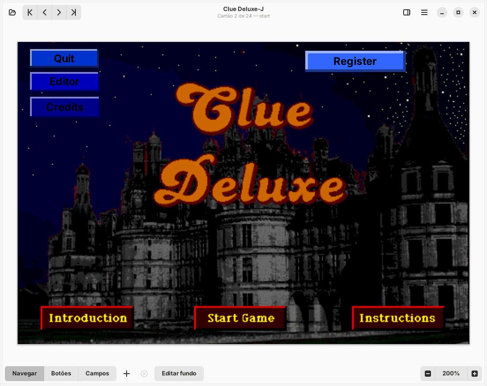
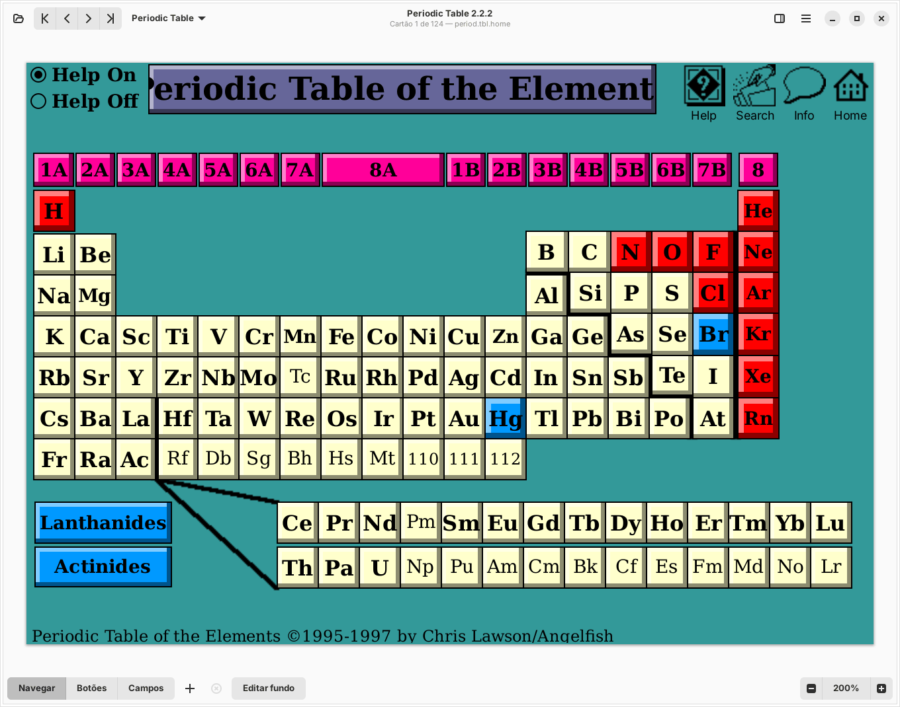
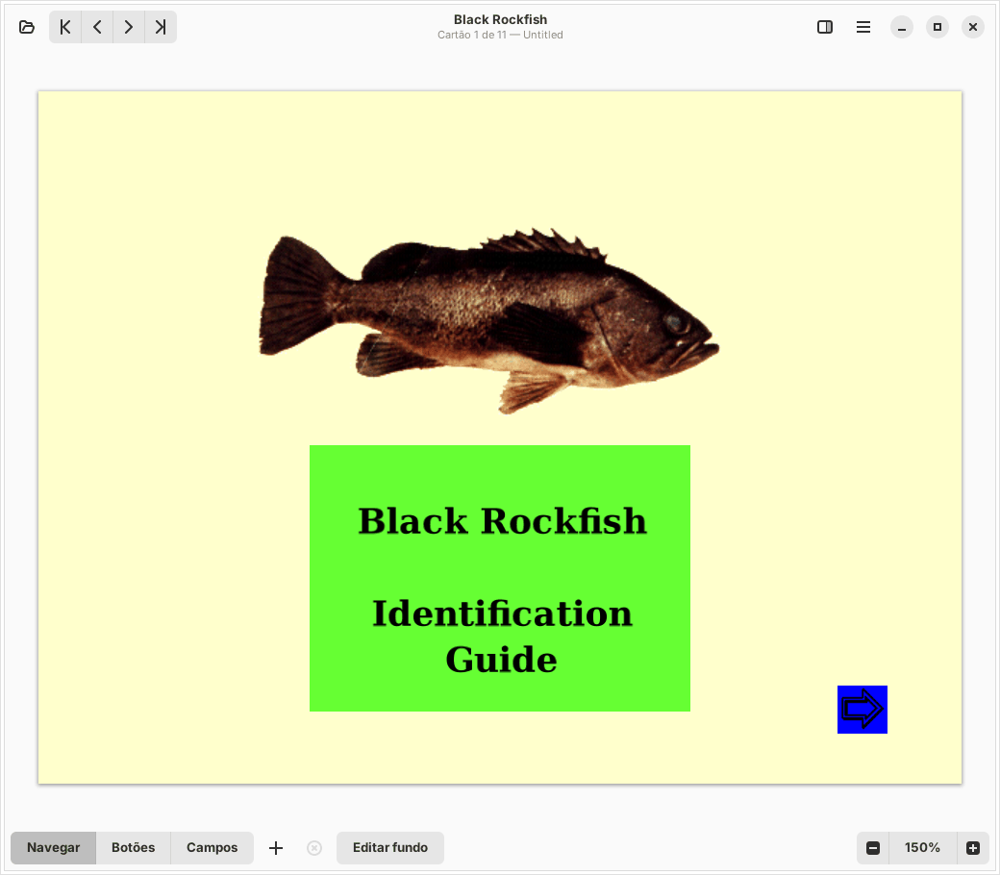
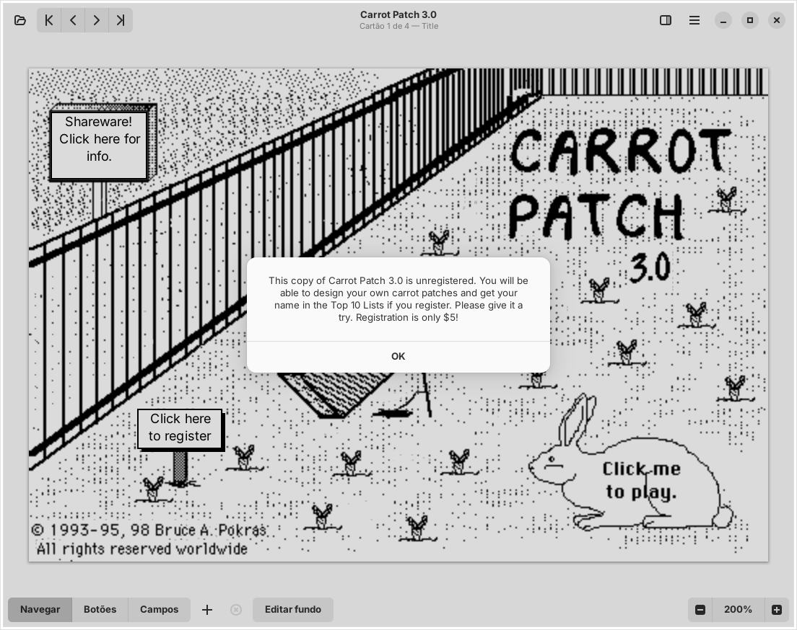
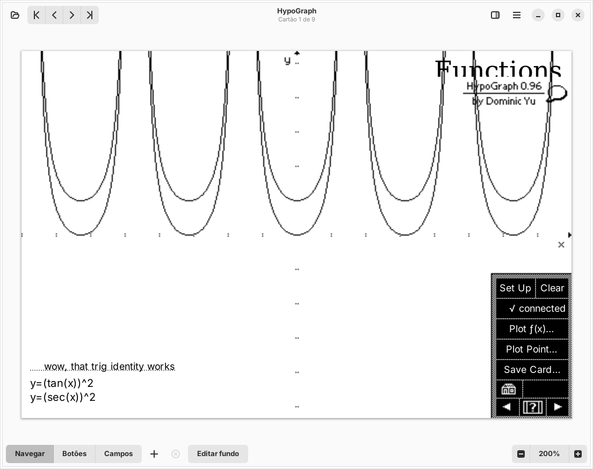
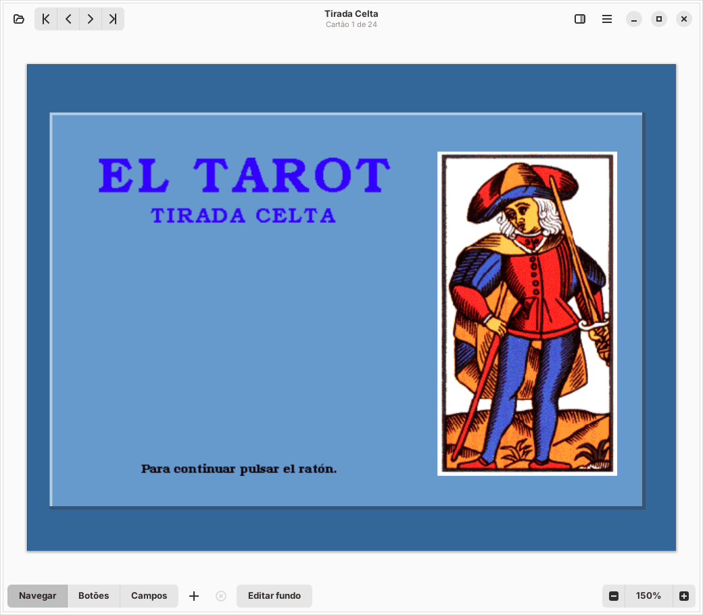
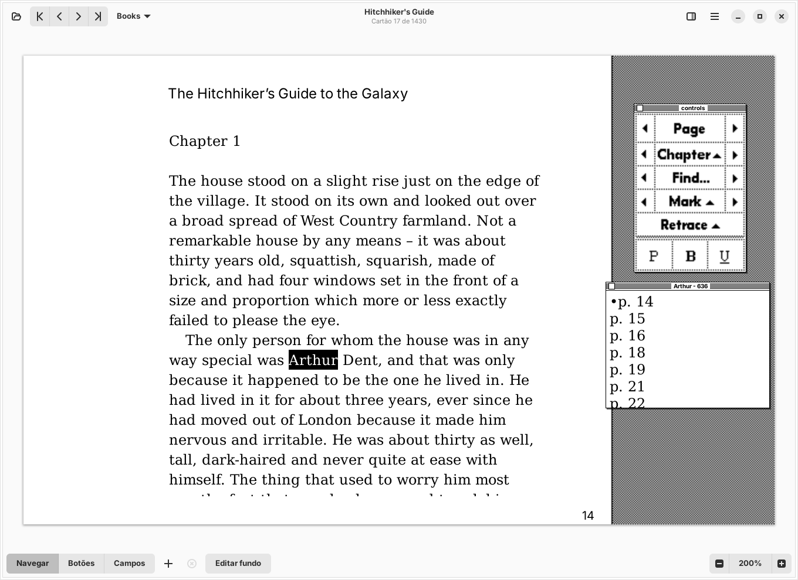
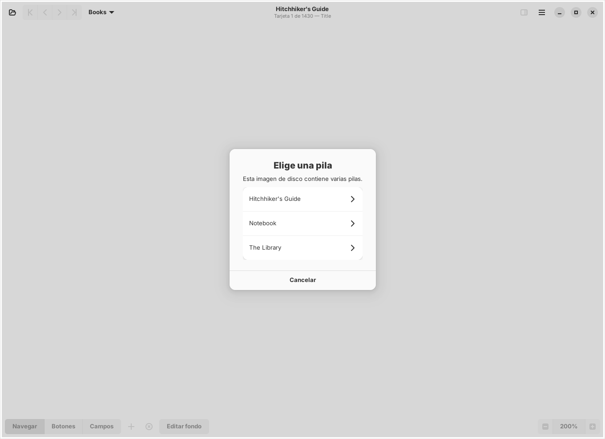
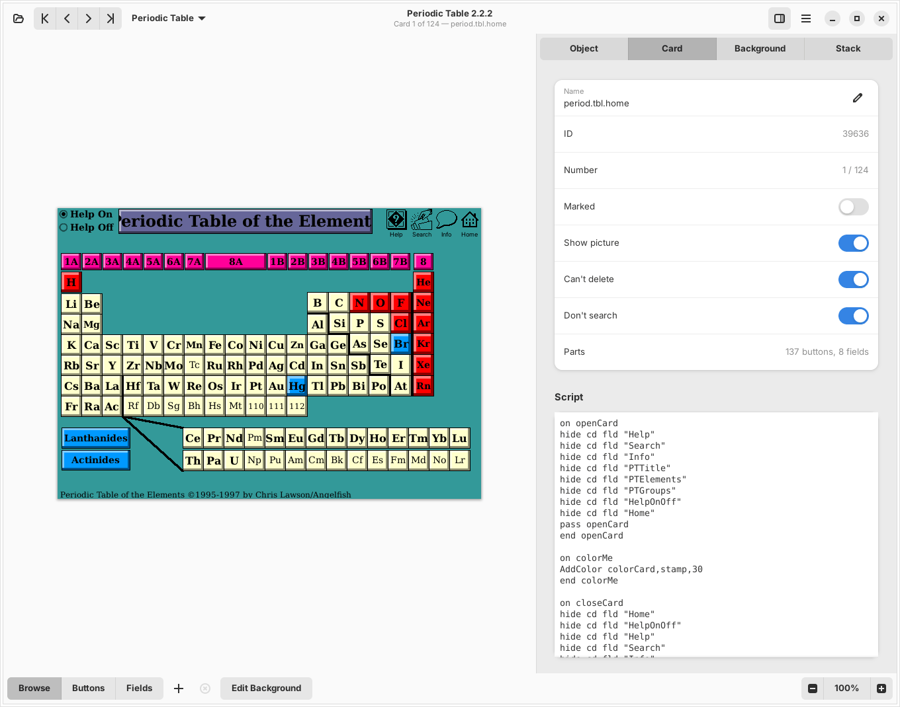

# HCX para Linux

HCX é um leitor de pilhas HyperCard do Mac clássico. Esta é a versão para Linux (GTK4 + libadwaita), portada do HCX original do pgostation, que era escrito em Objective-C/Cocoa para macOS.

## Capturas de tela



| | |
|---|---|
|  |  |
| *Periodic Table*: uma pilha educativa colorida com o AddColor | *Black Rockfish*: guia de identificação com fotos |
|  |  |
| *Carrot Patch*: jogo em preto e branco, com o diálogo do próprio script | *HypoGraph*: gráficos de funções desenhados em HyperTalk |
|  |  |
| *Tirada Celta*: figuras coloridas guardadas fora da pilha | *The Hitchhiker's Guide to the Galaxy* (Voyager): paleta e busca feitas pela própria pilha |
|  |  |
| Uma imagem de disco com mais de cem pilhas (interface em espanhol) | O inspetor mostra propriedades e scripts (interface em inglês) |

As capturas usam pilhas das coleções HyperCardVol1 e HyperCardVol2 e o *Hitchhiker's Guide* da Voyager, que serviram de teste. O conteúdo de cada pilha pertence aos seus autores e não faz parte deste projeto.

## Como rodar

```bash
chmod +x HCX-x86_64.AppImage
./HCX-x86_64.AppImage                       # abre a janela vazia
./HCX-x86_64.AppImage ~/Downloads/H2G2.img  # abre direto um arquivo
```

Você também pode dar dois cliques no arquivo pelo Arquivos (Nautilus), depois de marcá-lo como executável em Propriedades.

### Dependências

O AppImage usa o Python 3, o GTK 4 e a libadwaita que já vêm no sistema, por isso tem só 1 MB. No Fedora com GNOME (versão 40 ou mais nova) eles normalmente já estão instalados. Se faltar algo, o programa avisa e você instala com:

```bash
sudo dnf install python3-gobject gtk4 libadwaita
```

Se o AppImage reclamar de FUSE (raro no Fedora), rode `./HCX-x86_64.AppImage --appimage-extract-and-run`.

## Idiomas

A interface do HCX está em **português, inglês e espanhol**. Ela segue o idioma do sistema. Para trocar sem mexer no sistema, use o menu ☰ → **Idioma**. A escolha fica salva e vale quando o programa reinicia, e o aviso que aparece já tem o botão "Reiniciar agora".

As traduções são arquivos `.po` comuns, na pasta `hcx/locale/`. Qualquer pessoa pode traduzir para outro idioma com o Poedit ou outro editor de traduções. O passo a passo, em inglês e português, está em [TRANSLATING.md](TRANSLATING.md).

## O que ele abre

- Pilhas HyperCard 1.x e 2.x, inclusive as protegidas com "acesso privado"
- Pilhas em MacBinary (.bin), BinHex (.hqx), AppleSingle/AppleDouble (arquivos `._`) e com o resource fork ao lado (`.rsrc`)
- Arquivos StuffIt (.sit, .sit.hqx, StuffIt 1.5 a 5), sem precisar descompactar antes: o HCX lista as pilhas que estão dentro
- Imagens de disco HFS (.img, .dsk, .image, DiskCopy 4.2, com mapa de partições Apple). Se a imagem tiver várias pilhas (como a do H2G2), aparece uma lista para escolher.
- Também dá para arrastar o arquivo para dentro da janela.

Na primeira vez a pilha é convertida para um pacote `.hcxs`, guardado em `~/.local/share/hcx/stacks`. Das próximas vezes ela abre na hora.

## Como usar

- **Navegar:** setas ← → (ou PageUp/PageDown, espaço), Home/End, Ctrl+1/2/3/4 (primeiro, anterior, próximo, último, como no HyperCard), botões no topo
- **Voltar ao cartão anterior visitado:** Backspace ou Ctrl+Backspace
- **Zoom:** Ctrl+ / Ctrl− / Ctrl+0, ou os botões no canto inferior direito
- **Ferramentas (barra de baixo):** Navegar, Botões e Campos. Com Botões ou Campos você seleciona, arrasta, redimensiona pelos cantos, move com as setas (Shift = 10 px), apaga com Delete e cria objetos novos com o "+". "Editar fundo" (Ctrl+B) mostra só o fundo.
- **Inspetor (Ctrl+I):** propriedades da pilha, do fundo, do cartão e do objeto selecionado, incluindo os scripts HyperTalk (só para leitura)
- **Buscar (Ctrl+F):** procura o texto em todos os campos de todos os cartões, como o Find do HyperCard, e marca a palavra encontrada. Enter ou Ctrl+G vai para a próxima ocorrência.
- **Salvar (Ctrl+S):** guarda as edições (texto dos campos, botões e campos movidos, propriedades do inspetor). Elas continuam lá quando você abrir a pilha de novo. Ao fechar uma janela com alterações, o programa pergunta se quer salvar.
- **Imprimir cartão (Ctrl+P)** pelo diálogo de impressão do GNOME (também serve para gerar PDF), **copiar o cartão como imagem** (Ctrl+Shift+C) e **exportar o cartão como PNG**
- **Sons:** os sons da pilha tocam pelo sistema de som do Linux (GStreamer). Os sons comprimidos do Mac (MACE 3:1, MACE 6:1 e IMA 4:1), dentro da pilha ou em arquivos AIFF-C, são convertidos na hora. No inspetor, aba Pilha, há um botão para ouvir cada um.
- **Menu:** codificação do texto (Automática, Mac Roman ou Shift-JIS para pilhas japonesas), reimportar, exportar pacote `.hcxs`, nova janela (Ctrl+N)

## HyperTalk e XCMDs

A versão 3 tem um **interpretador HyperTalk completo**, escrito do zero em Python seguindo o *HyperCard Script Language Guide*:

- variáveis locais e globais, `if`/`else` (de uma linha e em bloco), todas as formas de `repeat`, `exit`, `next`, `pass`, `return`, `send`, `do`, `value()`;
- handlers e funções do autor, com o caminho de mensagens do HyperCard (botão → cartão → fundo → pilha → pilhas em uso com `start using` → HyperCard). Um handler do autor pode redefinir um comando do próprio HyperCard;
- pedaços de texto (`char`, `word`, `item`, `line`, intervalos e pedaços dentro de pedaços), propriedades de objetos, de trechos de texto e de janelas;
- `go` (com `in a new window`), `find` (todas as formas), `mark`/`unmark`, `sort` (inclusive `by`), `put`, `get`, `set`, contas, `answer`/`ask` (diálogos do GNOME), `lock screen` com `visual effect`, menus criados por script (`create menu`, `put … into menu`), arquivos (`open/read/write/close file`), `wait`, `idle`, `the mouse`, `the clickLoc` e cerca de cem funções.

Os **XCMDs/XFCNs** são código de máquina 68k do Mac e não rodam no Linux. Os mais usados foram reescritos em Python com o mesmo nome e os mesmos parâmetros, então os scripts chamam eles normalmente:

- **Textos e recursos:** GetStr, Get1Str, SetStr, ResID, listOfResources (e os recursos CSTR, STR, TEXT e twtx da pilha)
- **Menus e listas:** PopItUp e HPopUpMenu (menu suspenso no lugar do clique, com submenus), ListSelect, StripEm, CharInStr
- **Janelas:** Picture (paletas e imagens PICT), TextXWindow (janelas de texto/ajuda), Movie (vídeo pelo GTK)
- **Cores:** AddColor (botões, campos, retângulos e figuras coloridas, inclusive as cores já guardadas na pilha), colorizeHC, GetDepth
- **Arquivos:** GetFilesInDir, GetFileSize, GetPathInfo, DeleteFile, CreateFolder, AppendDataToFile, AppendStyleDataToFile, GetFileIndexedEntry
- **Texto e área de transferência:** SelectionToClip, AppendToClip, ChangeFontSizes, RemoveAttribute, RemoveUB, GetCharWidth, GetClickedWord, FontExists
- **Sistema:** MainScreenRect, GetScreenRects, PlayAIFFFile; MaxMem, SetDepth, HideDesktop e SetCustomIconBit não fazem nada (não precisam no Linux)

Um XCMD que não está nessa lista é ignorado em silêncio, como se não tivesse feito nada.

**Arquivos criados pelos scripts** (anotações, buscas salvas do H2G2 etc.) ficam numa pasta separada, `~/.local/share/hcx/files`. Os scripts só conseguem ler e gravar dentro dela. Assim, uma pilha antiga nunca apaga nem altera arquivos do seu sistema.

Para ver cada passo do HyperTalk no terminal, rode com `HCX_TRACE=1 ./HCX-x86_64.AppImage`.

### Testado com o H2G2 da Voyager

O *Hitchhiker's Guide* abre com a paleta de controles e o menu Books. Funcionam: Page, Chapter (menu de capítulos), Find (busca em todas as páginas, com a janela de resultados), Mark (clique rápido marca a página com a orelha; clique e segure mostra a lista de marcadores), Retrace (volta, ou lista o histórico se segurar), ajuda e registro.

## Diferenças em relação ao Mac

- **Fontes:** o Linux não tem as fontes bitmap do Mac (Chicago, Geneva, New York…). Elas são trocadas por Sans, Serif e Monospace do sistema, então algum texto pode quebrar a linha num lugar um pouco diferente.
- **As alterações vão para o pacote `.hcxs`, não para o arquivo HyperCard original**, que nunca é modificado. "Exportar pacote .hcxs…" faz uma cópia em outra pasta.
- Imagens HFS+ (Mac OS Estendido) ainda não são lidas. Só as imagens HFS clássicas.
- Partes do HyperTalk que dependem do Mac (AppleEvents, `the mouse` fora da janela, impressão de relatórios, paleta de pintura) não fazem nada.

O que ainda falta, e em que ordem, está no [ROADMAP.md](ROADMAP.md).

## Código-fonte

O código-fonte completo está neste repositório (também distribuído como `HCX-source.tar.gz`). É Python puro: não precisa compilar. Para rodar direto do código, sem AppImage:

```bash
cd hcx-linux                 # ou a pasta HCX-source/
python3 -m hcx              # ou: python3 -m hcx ~/Downloads/H2G2.img
./build-appimage.sh         # gera o AppImage de novo (precisa de mksquashfs e do runtime do AppImage)
```

## Créditos

- HCX original: pgostation (2013)
- Porte para Linux: feito pelo Claude (Anthropic) em 2026, a pedido de Gabriel, que também ajudou reunindo a documentação e as pilhas de teste
- Ícones padrão do HyperCard usados quando a pilha não traz os seus: projeto HyperCardPreview, de Pierre Lorenzi (licença MIT, incluída em `hcx/data/icons/`)
